<a href="https://shaheem.dev">
  <picture>
    <source media="(prefers-color-scheme: dark)" srcset="assets/header-dark.svg">
    
  </picture>
</a>

 

I build backend systems that ship, and I keep them running after launch. I pick the right tool for the problem, not the trendy one: Python while a product is still finding its shape, .NET when the workflow has to hold up inside an enterprise.

→ 3+ years building and maintaining production backend systems 
→ Systems supporting 20,000+ users across four cities 
→ Cut delivery processing time by 20% in live operations 
→ Raised vendor sales productivity by 40% with real-time tooling

**Now:** Software Developer at PaayaTech, building document pipelines for legal teams. 
**Before:** Product engineering at Unit Villa · Backend at Agua India · Backend at Cynbus. 
**On the side:** small native macOS apps in Swift.

<picture>
  <source media="(prefers-color-scheme: dark)" srcset="assets/ticker-dark.svg">
  
</picture>

## Selected work

| Project | What it does | Built with |
| :-- | :-- | :-- |
| **[Tifflo](https://tifflo.shaheem.dev)** | WhatsApp-first operations for tiffin kitchens. Replaces the WhatsApp-and-Excel juggle with a traceable meal ledger. | `Django` `PostgreSQL` `WhatsApp API` |
| **Agua India** [App Store](https://apps.apple.com/in/app/agua-india/id1503679371) · [Play Store](https://play.google.com/store/apps/details?id=appu.agua) | Water delivery for 20,000+ users across four cities, with delivery processing 20% faster in live operations. | `Django` `PostGIS` `Google Maps` |
| **[Food For All](https://github.com/AkshayBenny/food-surplus-detection)** | Matches surplus food with nearby NGOs by location, in real time. | `Django` `Next.js` `PostGIS` |

## How I work

- **Constraints are features.** Deadline, team size and budget shape the design before any framework does.
- **Prefer proven technology.** Boring stacks fail in ways you already know how to fix.
- **Write for the next developer.** It's usually me, six months later.
- **Make tradeoffs explicit.** Every shortcut gets written down, along with what it costs.

## Stack

<picture>
  <source media="(prefers-color-scheme: dark)" srcset="https://skillicons.dev/icons?i=python%2Cdjango%2Cfastapi%2Ccs%2Cdotnet%2Cts%2Cpostgres%2Cmysql%2Caws%2Cdocker%2Cgithubactions%2Cnextjs%2Cswift&theme=dark&perline=13">
  
</picture>

## Activity

<picture>
  <source media="(prefers-color-scheme: dark)" srcset="https://raw.githubusercontent.com/shaheem-pp/shaheem-pp/output/snake-dark.svg">
  
</picture>

 

  <a href="https://shaheem.dev">shaheem.dev</a> ·
  <a href="mailto:mail@shaheem.dev">mail@shaheem.dev</a> ·
  <a href="https://www.linkedin.com/in/shaheem-pp/">LinkedIn</a> ·
  <a href="https://twitter.com/the_codeholic">X</a>

